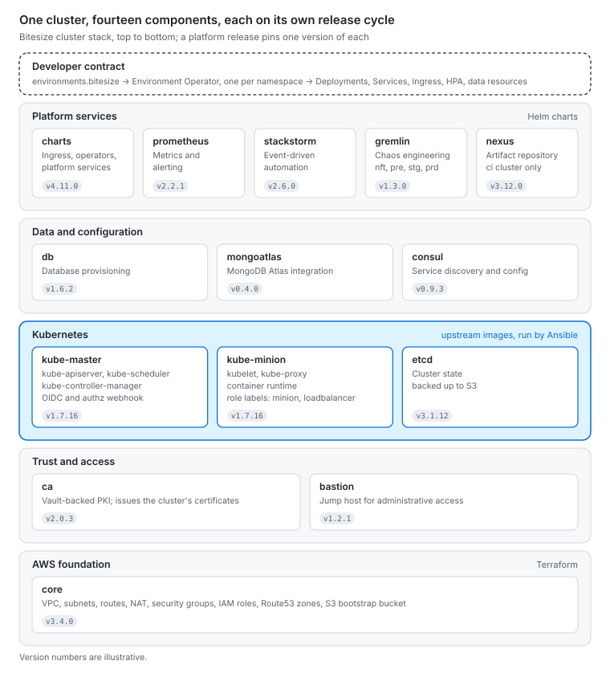
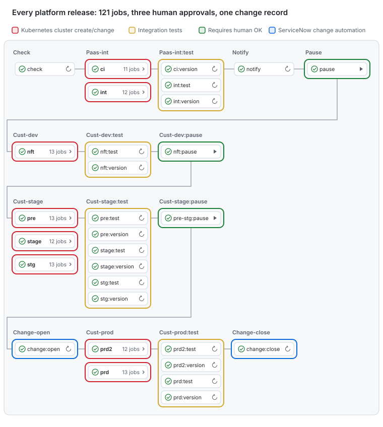

# Transforming the World's Largest Education Company with Kubernetes

**Ian Douglas** · [Read online](https://github.com/iancaseydouglas/resume/blob/main/files/bitesize/transforming-the-worlds-largest-education-company-with-kubernetes.md) · [Download PDF](https://github.com/iancaseydouglas/resume/blob/main/files/bitesize/transforming-the-worlds-largest-education-company-with-kubernetes.pdf)

*Continuous delivery of platform-as-a-product: how Pearson's Bitesize team built, versioned and released a self-managed Kubernetes platform on AWS, proven under 8.5 million concurrent users at sub-250 ms average response.*

Pearson set out to grow from 75 million to 200 million learners [1][2]. Bitesize, a self-managed Kubernetes platform on raw AWS EC2, was built to carry them: load-tested at 8.5 million concurrent users with a 150–250 ms average response, and run at 100% availability through critical business periods [3]. The team ran the platform as a product and delivered it continuously. Every cluster component, from the VPC to the API server, had its own version and release cycle. A platform release was a tested set of component versions, promoted through eight clusters to production in two regions.

## Contents

- [Summary](#summary)
- [1. Constraints: a treadmill of technology](#1-constraints-a-treadmill-of-technology)
- [2. Cluster substrate](#2-cluster-substrate)
- [3. Continuous delivery of the platform](#3-continuous-delivery-of-the-platform)
    - [3.1 Platform as a product](#31-platform-as-a-product)
    - [3.2 Building a cluster, component by component](#32-building-a-cluster-component-by-component)
    - [3.3 Versioning and releases](#33-versioning-and-releases)
    - [3.4 The release pipeline](#34-the-release-pipeline)
    - [3.5 Earlier: A/B cluster upgrades](#35-earlier-ab-cluster-upgrades)
- [4. Kubernetes as the control plane for AWS](#4-kubernetes-as-the-control-plane-for-aws)
- [5. Developer experience](#5-developer-experience)
- [6. Security](#6-security)
- [7. Networking, configuration and edge](#7-networking-configuration-and-edge)
- [8. Data](#8-data)
- [9. Observability](#9-observability)
- [10. Validation](#10-validation)
- [11. Governance and economics](#11-governance-and-economics)
- [12. Open source](#12-open-source)
- [13. Capability ledger](#13-capability-ledger)
- [14. Takeaways](#14-takeaways)
- [References](#references)

## Summary

Before Bitesize, delivery could not keep pace with that ambition: environments took up to nine months to provision, releases shipped once or twice per academic year, and roughly 400 development groups each ran software their own way [1].

Pearson adopted Kubernetes at version 1.2 in early 2016, presented the platform at KubeCon EU and KubeCon North America that year [42][43][44], and was later featured as a case study by kubernetes.io and the CNCF [1][2].

Its architect called Bitesize a "treadmill of technology" [3]. There was no EKS, no CRDs before Kubernetes 1.7, no Operator SDK, no Crossplane and no AWS Controllers for Kubernetes. The team wrote its own controllers, operators and automation, and replaced them as the ecosystem caught up.

| Metric | Result | Source |
| --- | --- | --- |
| Release cadence | 1–2 per academic year → multiple per day | [1] |
| Environment provisioning | Up to 9 months → minutes | [1] |
| Developer productivity | +15–20% | [1] |
| Availability | 100% for platform and applications through critical business periods | [3] |
| Concurrency | 8.5M concurrent users; 150–250 ms average response | [3] |
| Throughput | 28M requests in 10 minutes under Locust | [2] |
| Network | Full BGP mesh across regions; new endpoints in under 10 s | [3] |
| Onboarding | Self-service to production with little or no platform-team involvement | [3] |

## 1. Constraints: a treadmill of technology

| Need | State of the ecosystem, 2016 | What Bitesize built |
| --- | --- | --- |
| Managed control plane | None; EKS reached general availability in mid-2018 | Terraform- and S3-bootstrapped clusters with self-managed etcd and PKI |
| Declarative cloud resources | No CRDs until 1.7; Crossplane and AWS Controllers for Kubernetes came later | Third-Party Resources reconciled by StackStorm; later, in-house CRDs for VPCs and databases |
| Operators | Pattern barely named; no SDK | Environment Operator |
| Fine-grained authorization | RBAC not yet mature | An authorization webhook |
| GitOps | Term not yet coined | In-house reconciliation from Git |
| Functions on Kubernetes | Early, untested frameworks | IronFunctions, after a comparative evaluation |

Pearson was simply too far ahead of the curve to entertain a managed service, and would have run the full stack itself regardless. Implementation followed one rule: declarative Ansible wherever possible, with glue in Python, Bash or Go.

## 2. Cluster substrate

Clusters ran on raw EC2. kops was not used.

- **Network.** Terraform defined each VPC with dedicated tenancy, an internet gateway, a public and a private subnet in each of three availability zones, NAT, ACLs, IAM roles, and security groups limited to the VPC CIDR [4].
- **Bootstrapping from S3.** Terraform rendered cluster configuration and scripts into a per-environment S3 bucket. Instances booted a stripped-down CentOS AMI with Docker and the AWS CLI baked in. At boot, user-data located the master, pulled the scripts for its role (master or minion) from S3, configured the node and joined the cluster [4].
- **Masters.** Masters ran in an auto-scaling group behind an ELB, with Route53 records in a public zone and an internal private zone created automatically [4].
- **etcd.** etcd ran on the master and was backed up to S3 frequently. A replacement master restored etcd from S3 before starting services [4].
- **Edge nodes.** Ingress minions were labelled `role=loadbalancer`, placed in a DMZ, and claimed pre-allocated Elastic IPs at boot so DNS never changed [4].
- **Placement.** Zone labels and a custom scheduler policy (ServiceSpreadingPriority, weight 2) spread pods across availability zones [5].
- **DNS.** kube-dns was tuned with dnsmasq caching and forwarding of non-cluster lookups to the VPC resolver [6]. Stale resolvers and `ndots:5` NXDOMAIN storms behind the ingress tier were fixed first with host-level dnsmasq, then with a sidecar [7].

## 3. Continuous delivery of the platform

### 3.1 Platform as a product

Bitesize was run as a product with internal customers: roughly 400 development groups. Its interface was the `environments.bitesize` contract, the Environment Operator API, and the platform services every namespace inherited. Like any product, it shipped continuously: small, versioned, tested changes promoted along the same path every time, never an infrequent big-bang upgrade.

The unit of change was the component, not the platform. Each part of a cluster had its own code, tests, version and release cycle, so the owners of Vault PKI or the ingress tier could ship without waiting for a Kubernetes upgrade, and a Kubernetes upgrade could ship without touching either.

### 3.2 Building a cluster, component by component

Every cluster is assembled by the same pipeline jobs, one per component. Each job pairs two tools:

- **Terraform** creates and changes the AWS resources the component needs.
- **Ansible** configures what runs on them, declaratively wherever possible, with glue in Python, Bash or Go.

The Kubernetes control plane runs from the upstream container images that the Kubernetes project builds and publishes for each component: kube-apiserver, kube-controller-manager, kube-scheduler and kube-proxy. Pearson did not fork or rebuild Kubernetes. Ansible renders the manifests, flags and certificates that run the upstream images, so adopting a new Kubernetes release means changing a version, not a build.

Jobs run in dependency order: `core` first, `ca` before anything that needs a certificate, `etcd` before the control plane, masters before workers, platform services last. Each job converges its component to the requested version and leaves everything else alone, so the same jobs create a new cluster or change an existing one.



| Job | What it builds | Scope |
| --- | --- | --- |
| core | VPC, subnets, routes, NAT, security groups, IAM roles, Route53 zones, and the S3 bucket holding node bootstrap configuration | All |
| bastion | Jump host for administrative access | All |
| ca | Vault-backed certificate authority issuing the cluster's certificates | All |
| etcd | The cluster's key-value store, backed up to S3 | All |
| kube-master | Masters behind an ELB, running the upstream kube-apiserver, kube-controller-manager and kube-scheduler images, with OIDC and the authorization webhook configured | All |
| kube-minion | Worker auto-scaling groups: container runtime, kubelet, upstream kube-proxy, and node role labels | All |
| consul | Service discovery and configuration | All but `ci` |
| charts | Helm-packaged platform services | All |
| db | Database provisioning | All |
| mongoatlas | MongoDB Atlas integration | All |
| prometheus | Metrics and alerting | All |
| stackstorm | Event-driven automation | All but `ci` |
| gremlin | Chaos engineering | `nft`, `pre`, `stg`, `prd` |
| nexus | Artifact repository | `ci` only |

After the build jobs, each tier runs two kinds of check. `test` jobs exercise the assembled cluster. `version` jobs confirm that every component reports exactly the version the release specified.

### 3.3 Versioning and releases

Each component is versioned and released on its own cycle:

- **Upstream components** track the Kubernetes and etcd releases.
- **Pearson components** follow their own cadence: Environment Operator, the ingress controller, the authorization webhook, the charts and the infrastructure modules.

A platform release is therefore not one number but a set of them: a manifest pinning a tested version of every component.

```yaml
# Platform release manifest (illustrative; versions are examples)
platform: bitesize
release: 2018.06.2
components:
  core: 3.4.0
  bastion: 1.2.1
  ca: 2.0.3
  etcd: 3.1.12            # upstream
  kube-master: 1.7.16     # upstream images
  kube-minion: 1.7.16     # upstream images
  consul: 0.9.3
  charts: 4.11.0
  db: 1.6.2
  mongoatlas: 0.4.0
  prometheus: 2.2.1
  stackstorm: 2.6.0
  gremlin: 1.3.0
  nexus: 3.12.0
```

A typical change moves one line:

1. A component team releases a new version.
2. A new platform release manifest is cut, differing from the last in that component alone.
3. The pipeline builds it into `ci` and `int`, then promotes it through `nft`, through `pre`, `stage` and `stg`, and into `prd` and `prd2`, with tests, version checks and human approval at each tier.

What this buys:

- **Small blast radius.** Most releases change one component, and the diff names it.
- **Independent cadence.** Fast-moving pieces ship as often as they are ready; the control plane moves when upstream and testing allow.
- **Reproducibility.** Any platform release can be rebuilt exactly from its manifest.
- **Rollback.** Redeploy the previous manifest.
- **Audit.** The change record for production can name exactly which component versions moved.

This is continuous delivery applied to the platform itself, not only to the applications on it.

### 3.4 The release pipeline

Orchestration began with StackStorm: webhooks triggered workflows that sequenced Terraform, Ansible and Kubernetes API calls, and ChatOps reported progress [11]. GitHub Actions later replaced StackStorm as the rollout engine; StackStorm remained as an in-cluster automation service.

The current pipeline deploys the platform itself: 121 jobs across eight clusters in four tiers.



| Tier | Clusters | Exit gate |
| --- | --- | --- |
| Platform-internal | `ci`, `int` | Tests, version checks, human approval |
| Customer dev | `nft` | Tests, version checks, human approval |
| Customer stage | `pre` (integration after all dev stages); `stage`, `stg` (developer-facing staging) | Tests, version checks, human approval |
| Production | `prd`, `prd2` (second region) | ServiceNow change opened before, closed after |

Every cluster is built by the same per-component jobs, so production receives the eighth identical deployment of a release, never the first.

Governance is encoded, not remembered:

- Integration tests and version checks gate every tier.
- A human approves after the platform-internal tier, after customer dev and before production.
- The ServiceNow change opens just before production and closes just after.

### 3.5 Earlier: A/B cluster upgrades

Before the component pipeline, upgrades replaced whole clusters. Kubernetes moved too fast for in-place control-plane upgrades to be safe, so whole clusters were treated as immutable.

- **Shell VPC.** A separate, long-lived Terraform and Ansible codebase built the "shell": subnets, routes, security groups, a bastion, the DNS zone, the gateway, and two persistent ELBs, one live and one pre-live [8].
- **Build B beside A.** Terraform stood up a fresh cluster, paasB, beside paasA. Namespaces, secrets, quotas, ACLs and per-namespace Jenkins were recreated from paasA's API, and applications were redeployed from Git. StackStorm and the Python Kubernetes client orchestrated the migration [8].
- **Shift traffic.** paasB sat behind the pre-live ELB for smoke and end-to-end tests. Ingress minions carried AWS labels so ELBs, Route53 records and target groups could be repointed to bleed traffic from A to B. paasA was kept for rollback, then destroyed [8].
- **State across the gap.** The hard problem was carrying Consul, and the Vault data stored in it, across clusters. Option one bridged a single Consul cluster across both by routing pod networks between them; it was simple but one mistake could take down everything. Option two ran separate Consul clusters kept in step by a sync application, preserving isolation at the cost of moving parts. The proof of concept built option two [8].
- **Validation.** Every pull request triggered TravisCI to build a VPC with both clusters, with paasB running BATS tests against paasA, in about 25 minutes [9]. The harness later became `kubernetes-tests`, a containerized runner for BATS, InSpec and Python suites executed as Kubernetes Jobs [10].
- **Outcome.** 100% platform availability through critical business periods, with clusters and the CI/CD pipeline treated as cattle: anything that disappeared reconfigured itself on return [3].

## 4. Kubernetes as the control plane for AWS

### 4.1 Third-Party Resources and StackStorm (February 2016)

Before CRDs, the team used Kubernetes Third-Party Resources (TPRs) so developers could request AWS infrastructure in ordinary Kubernetes YAML.

1. **Declare.** A TPR, `mysql-db.prsn.io`, served `/apis/prsn.io/stable/v1/mysqldbs`. A developer submitted a `MysqlDb` object naming an engine version and an instance size [12].
2. **Watch.** A StackStorm sensor, `thirdpartyresource.py`, watched `/apis/extensions/v1beta1/watch/thirdpartyresources` [13][14].
3. **Provision.** A rule fired an action chain that parsed the spec and called AWS through StackStorm's AWS pack to create the RDS instance or S3 bucket [12][13].
4. **Feed back.** The chain wrote connection strings and credentials into Consul and Vault, where applications consumed them. No developer touched the AWS console [12].

The work was contributed upstream as st2contrib pull request #395; `pearsontechnology/st2contrib` carried the Kubernetes pack and its sensors [13][14].

```yaml
# Illustrative request, after [12]
apiVersion: prsn.io/stable/v1
kind: MysqlDb
metadata:
  name: learner-api-db
spec:
  engine_version: 5.6.23
  instance_size: huge
```

### 4.2 Generated automation

Hand-writing integrations did not scale, so the team generated them.

- **Kubernetes.** A Kubernetes pack generated from the API specification in December 2016 provided 365 actions and 33 sensors, and was contributed to StackStorm Exchange [15][16].
- **AWS.** StackStorm AWS packs were generated programmatically: more than 106 next-generation packs went into the Exchange incubator [3]. A boto3 pass-through pack exposes any AWS API through two generic actions [17].
- **Effect.** Mapping a new custom resource to AWS became a matter of generation, not hand-written integration code.

### 4.3 Custom resources for VPCs and data tiers

When CRDs arrived, the pattern moved to them. Pearson rolled its own CRDs to provision AWS services such as VPCs and databases, so application teams declared data tiers next to their workloads.

Environment Operator added an external-resource type covering MongoDB, MySQL, Cassandra, Redis, ZooKeeper, Kafka and PostgreSQL [19]. Provisioned endpoints and credentials flowed into Consul and Vault, linking Kubernetes services to RDS and ElastiCache.

### 4.4 GitOps before the term

Git held desired state for the platform and its applications, applied by in-house tooling. Environment Operator polled each repository every 30 seconds, applied changes, and removed resources no longer declared [19]. Before it, a stateless Jenkins in each namespace redeployed applications from Git [8][22].

## 5. Developer experience

### 5.1 Project creation through ChatOps

A developer typed `hubot create myfirstproject email@someemail.com` [21]. One command:

- created a Git repository populated with boilerplate application and container data;
- provisioned isolated namespaces with standard development, staging and production environments;
- started a project Hubot and a Jenkins wired to the repository;
- created a service account;
- opened a chat room (HipChat at launch, Slack later) and sent email invitations [21];
- later, instructed Environment Operator to provision the Dev and QA namespaces.

The bot was built from CoffeeScript modules for Kubernetes, repository and chat clients [21]. It authenticated with basic auth at first, then OpenID Connect tokens.

### 5.2 Standardized application packages

With roughly 400 teams, free-form Dockerfiles were unmanageable [22].

- **Base images.** An Application Engineering group built and secured base images for Java, Node.js, Python, Go and Ruby. A `.deb` package for each stack codified the install process, directory layout and language version [22].
- **Build file.** Each repository carried a `default.json` naming its build types, metadata (name, version, namespaces, minimum and maximum instances), build steps and artifacts [22].
- **Flow.** Jenkins polled repositories (deliberately not webhooks), ran tests, built the `.deb`, published it to an apt repository, layered it onto the base image, pushed the image, deployed, ran integration tests, reported to Hubot, and promoted from Stage to Prod [22].
- **Base-image changes.** A new base image triggered rebuilds [22].
- **Tradeoff.** Developers never wrote a Dockerfile. They also could not adopt a new language version until App Engineering had vetted and packaged it, a recurring source of pushback [22].

### 5.3 The deployment pipeline

- **Release.** The Jenkins deployment-pipeline plugin was open-sourced at KubeCon Seattle in November 2016 [23][25].
- **Stages.** The build stage required a Debian artifact layered onto the approved base image. The deploy stage targeted multi-environment namespaces. Test Kitchen was supported [23].
- **Design.** The pipeline was language-agnostic and driven by three YAML files, with a local aptly cache of packages and Jenkins slaves started on demand. The team compared it publicly with Fabric8 [24].
- **Early schema.** An early `environments.bitesize` schema chained environments through `next_environment` (dev → qa → stg → prd) and supported blue/green deployments with an active-colour toggle [45].
- **Registry moves.** `migr8-registry-gcloud` copied every repository and tag from a private v2 registry's catalog into Google Container Registry [27].

### 5.4 Environment Operator

The platform abstracted a namespace into an Environment: Dev, QA, Staging or Prod. Environment Operator, written in Go and open-sourced in 2017, owns that abstraction [18][19].

```yaml
# environments.bitesize (illustrative, after [19][20])
project: learner-api
environments:
  - name: production
    namespace: learner-api-prd
    deployment:
      method: rolling-upgrade
    services:
      - name: api
        application: learner-api
        version: 1.4.2
        external_url: api.example.com
        port: 8080
        ssl: "true"
        replicas: 3
        hpa:
          min_replicas: 3
          max_replicas: 20
          target_cpu_utilization_percentage: 70
        health_check:
          command: ["/bin/healthcheck"]
      - name: sessions
        database_type: mongo
        version: "3.6"
        replicas: 3
    tests:
      - repository: git@example.com:learner/api-tests.git
        branch: master
        commands:
          - run-tests.sh
```

- **Scope.** One operator per namespace, running under a namespace-scoped service account [18][19].
- **Reconciliation.** Over SSH, it refreshes Git, loads its environment's section, applies only what changed, and reaps removed resources [19].
- **Baseline.** For each team it lays down RBAC roles, Vault policies, default network policies and resource quotas.
- **Resources.** Deployments, Services, Ingresses, HPAs, dynamically provisioned EBS and EFS volumes, MongoDB StatefulSets and external-resource CRDs [19].
- **Guardrails.** Autoscaling is capped (50 replicas by default), CPU and memory have ceilings and defaults, and workloads schedule only onto `role=minion` nodes [19].
- **API.** `POST /deploy` takes a service, application and version. `GET /status`, `/status/{service}` and `/status/{service}/pods` report state, the last including recent pod logs. Prometheus metrics are exported [19].
- **Authentication.** A bearer token from a file, or an OIDC token from Keycloak whose groups must match an allow-list [19].
- **Audit.** Every deployment is recorded, giving an audit trail and status per namespace [18].
- **Build and deploy, separated.** Any CI system builds and pushes artifacts; the operator performs the rollout, so deployments are auditable and roll back by redeploying a prior version [18]. The same contract drives deployments across multiple clusters.
- **Jenkins integration.** A companion plugin adds a build step and a Job DSL `deploy_to_environment` block, and passes or fails the job on deployment status [19][26].

## 6. Security

The model was zero trust, adopted before the term was common.

- **Authentication.** Keycloak served OpenID Connect to the API server on Kubernetes 1.2.2, with the email claim as the username and an `mod_auth_openidc` gateway in front [28].
- **Authorization before mature RBAC.** `bitesize-authz-webhook`, written in Go and open-sourced, evaluates every API request against HCL allow and deny rules [29]:
  - the first matching rule wins and anything unmatched is denied;
  - group ACLs come from the identity provider, with TLS and templated namespace matching;
  - it runs as a static pod on controller nodes.

  A developer could change only their own namespace; the platform team held cluster-admin. CoreOS adopted the webhook [3].
- **RBAC.** As Kubernetes RBAC matured, identity-provider users and groups mapped directly to namespace RoleBindings.
- **Vault.** Vault ran in-cluster from January 2016, backed by Consul, with scripted initialization and unseal [30]. Later it ran as three health-checked replicas, reachable from the corporate network so secrets could be pushed in [31].
- **Dynamic secrets.** Applications held no static credentials. Vault issued TTL-bound database credentials, and secrets for resources that StackStorm provisioned were written into Vault without human hands [12].
- **Dynamic certificates.** The Vault-backed nginx ingress controller fetched the certificate for any Ingress labelled `ssl: true` and reloaded [32]. Vault was wired into AWS ELBs for automated TLS, and every cluster ran its own Vault-backed certificate authority.
- **Coverage.** OAuth reached the platform and its infrastructure components, with audit and compliance controls throughout the stack [3].

## 7. Networking, configuration and edge

- **Mesh.** A highly secure full BGP mesh across geographic regions could stand up new endpoints in under 10 seconds [3].
- **Address management.** Dynamic CIDR allocation, using NSOT, covered both AWS and Kubernetes [3].
- **Consul deployment.** Consul was deployed by Terraform alongside each cluster as three nodes [34], and later formed its own cluster by discovering peers through the Kubernetes API [35].
- **Consul's role.** Kubernetes handled internal DNS. Consul carried service discovery and configuration across the wider VPC, linking Kubernetes services to RDS and ElastiCache.
- **Dynamic configuration.** envconsul injected Consul key/value data as environment variables, so configuration and secrets stayed off the filesystem [33].
- **Universal API.** A single API over Kong, backed by PostgreSQL, configured gateways across regions. Custom plugins handled rewrites, HTTPS redirects and dynamic ACLs [36].

## 8. Data

- **Isolation.** Each service got its own database, and network policy bound a namespace to its own data tier.
- **Provisioning.** Databases were provisioned automatically as containers or virtual machines [3]: RDS through TPR and later CRD requests [12], and MongoDB as StatefulSets with keyfile authentication, replica sets and a discovery sidecar [19][38].
- **Location.** Early on, most databases ran on VMs outside Kubernetes while persistent storage matured [8]. Today a `mongoatlas` job connects every cluster to MongoDB Atlas.
- **Configuration.** PodPresets injected database configuration while keeping upstream images unmodified [39].

## 9. Observability

- **Logs.** A Fluentd agent on every node tailed container logs and routed them to a Kafka topic named for the namespace, giving log aggregation per namespace [37].
- **Metrics.** Prometheus runs in every cluster, and Environment Operator exports its own metrics [19].
- **Alerting.** Monitoring and alerting were integrated throughout the stack [3].

## 10. Validation

- **Scale.** 8.5 million concurrent users at 150–250 ms average response [3], and 28 million requests in 10 minutes [2].
- **Load on demand.** Locust ran on IronFunctions. A test suite deployed in under 10 seconds, ran against an environment, logged results and tore itself down, with no standing test fleet [3][40].
- **Choosing a functions framework.**
  - IronFunctions was the dark horse: it ran any image, synchronously or asynchronously, at about 200–250 ms synchronous and 300 ms asynchronous, with its database out of the request path [40].
  - Kubeless integrated tightly with Kubernetes, including CRDs, RBAC and Prometheus, but supported only Python and Node.js [40].
  - OpenWhisk was rejected: it was asynchronous only, put CouchDB and Kafka in the request path, and bypassed the scheduler [40].
- **Failures found early.** A 6,500-user test exhausted an under-provisioned kube-dns, and an etcd restore then wiped node labels. Both were written up publicly [41].
- **Chaos and replicas.** Gremlin runs in `nft`, `pre`, `stg` and `prd`. Production-scale replicas are created for each test window and torn down after.

## 11. Governance and economics

- **Governance.** Enterprise governance was built in: audit and compliance throughout the stack, pipeline gates, and automated ServiceNow changes [3].
- **Chargeback.** An enterprise chargeback model attributed platform cost to the teams that incurred it [3].
- **Single API.** A universal API gave one point of use for platform capabilities [3].
- **Self-service.** Applications reached production with little or no help from the Bitesize team [3].

## 12. Open source

| Project | Purpose | Refs |
| --- | --- | --- |
| `environment-operator` | Per-namespace deployment operator | [18][19] |
| `environment-operator-jenkins-plugin` | Jenkins build step for Environment Operator | [26] |
| `deployment-pipeline-jenkins-plugin` | Build-and-deploy pipeline, released at KubeCon Seattle 2016 | [23][25] |
| `bitesize-authz-webhook` | Default-deny authorization webhook, adopted by CoreOS | [3][29] |
| `st2contrib` | StackStorm Kubernetes pack and TPR sensors | [14] |
| `kubernetes-tests` | Containerized cluster test harness | [10] |
| `migr8-registry-gcloud` | Registry migration to Google Container Registry | [27] |
| `bitesize-controllers` | Vault-backed nginx ingress controller | [32] |
| StackStorm Kubernetes and AWS packs | Generated automation coverage | [15][16][3] |
| Kong plugins | Rewrite, HTTPS redirect, dynamic ACL | [36] |

## 13. Takeaways

1. A narrow developer contract scales; teaching 400 groups Kubernetes does not.
2. Deliver the platform continuously, as a product: version every component independently and release tested sets of versions.
3. Self-managing the full stack is tractable when one pipeline rebuilds every component the same way, from upstream images.
4. Make Kubernetes the control plane for everything, cloud resources included
5. Governance belongs in the pipeline: tests per tier, explicit approvals, automated change records.
6. Early adopters build the primitives the market later sells. Plan to replace your own.
7. Test at the load you fear and against the failures you expect, then publish what broke.

## References

1. Kubernetes.io, ["Reinventing the World's Largest Education Company With Kubernetes"](https://kubernetes.io/case-studies/pearson/)
2. CNCF, ["Pearson: Reinventing the world's largest education company with Kubernetes"](https://www.cncf.io/case-studies/pearson/)
3. devoperandi, ["My exit from a great gig"](https://www.devoperandi.com/my-exit-from-a-great-gig/), Nov 2017
4. devoperandi, ["Kubernetes/Terraform – Multiple availability zone deployments"](https://www.devoperandi.com/kubernetesterraform-multiple-availability-zone-deployments/), Jan 2016
5. devoperandi, ["Kubernetes – Scheduling and multiple availability zones"](https://www.devoperandi.com/kubernetes-scheduling-and-multiple-availability-zones/), May 2016
6. devoperandi, ["Kube-DNS – a little tuning"](https://www.devoperandi.com/kube-dns-a-little-tuning/), Oct 2016
7. devoperandi, ["The perils of a Kube-DNS issue with Nginx ingress"](https://www.devoperandi.com/the-perils-of-a-kube-dns-issue-with-nginx-ingress/), May 2017
8. devoperandi, ["Kubernetes: A/B cluster deploys"](https://www.devoperandi.com/kubernetes-ab-cluster-deploys/), Aug 2016
9. devoperandi, ["Kubernetes/PaaS: Automated test framework"](https://www.devoperandi.com/kubernetespaas-automated-test-framework/), Aug 2016
10. [pearsontechnology/kubernetes-tests](https://github.com/pearsontechnology/kubernetes-tests)
11. StackStorm, ["Case study: Pearson"](https://stackstorm.com/case-study-pearson/)
12. devoperandi, ["Kubernetes, StackStorm and third party resources"](https://www.devoperandi.com/kubernetes-automation-with-stackstorm-and-thirdpartyresources/), Feb 2016
13. devoperandi, ["Kubernetes, StackStorm and third party resources – Part 2"](https://www.devoperandi.com/kubernetes-stackstorm-and-third-party-resources-part-2/), Feb 2016
14. [pearsontechnology/st2contrib](https://github.com/pearsontechnology/st2contrib)
15. devoperandi, ["StackStorm for Kubernetes just took a giant leap forward"](https://www.devoperandi.com/stackstorm-for-kubernetes-just-took-a-giant-leap-forward/), Dec 2016
16. StackStorm, ["Introducing pack maintainers"](https://stackstorm.com/2017/03/15/introducing-pack-maintainers/), Mar 2017
17. devoperandi, ["How to use StackStorm AWS (boto3) pack"](https://www.devoperandi.com/how-to-use-stackstorm-aws-boto3-pack-to-interact-with-aws-services/), Dec 2017
18. devoperandi, ["Open source – Environment Operator"](https://www.devoperandi.com/open-source-environment-operator/), Sep 2017
19. [pearsontechnology/environment-operator](https://github.com/pearsontechnology/environment-operator)
20. Michael Ward, [`environments.bitesize` example](https://gist.github.com/mward29/a4ae8cd0df984c708ecd51973faed9ef)
21. devoperandi, ["Integrating Hubot and Kubernetes"](https://www.devoperandi.com/integrating-hubot-and-kubernetes/), Dec 2015
22. devoperandi, ["How we do builds in Kubernetes"](https://www.devoperandi.com/how-we-do-builds-in-kubernetes/), Jan 2016
23. devoperandi, ["Kubernetes continuous deployment pipeline"](https://www.devoperandi.com/kubernetes-continuous-deployment-pipeline/), Nov 2016
24. devoperandi, ["Deployment pipeline options for Kubernetes"](https://www.devoperandi.com/deployment-pipeline-options-for-kubernetes/), Dec 2016
25. [pearsontechnology/deployment-pipeline-jenkins-plugin](https://github.com/pearsontechnology/deployment-pipeline-jenkins-plugin)
26. [pearsontechnology/environment-operator-jenkins-plugin](https://github.com/pearsontechnology/environment-operator-jenkins-plugin)
27. [pearsontechnology/migr8-registry-gcloud](https://github.com/pearsontechnology/migr8-registry-gcloud)
28. devoperandi, ["Kubernetes authentication – OpenID Connect"](https://www.devoperandi.com/kubernetes-authentication-openid-connect/), Jun 2016
29. [pearsontechnology/bitesize-authz-webhook](https://github.com/pearsontechnology/bitesize-authz-webhook); devoperandi, ["Kubernetes-authz-webhook"](https://www.devoperandi.com/kubernetes-authz-webhook/), Oct 2016
30. devoperandi, ["Vault in Kubernetes"](https://www.devoperandi.com/vault-in-kubernetes/), Jan 2016
31. devoperandi, ["Vault in Kubernetes – Take 2"](https://www.devoperandi.com/vault-in-kubernetes-take-2/), May 2016
32. devoperandi, ["Open source – Bitesize-controllers"](https://www.devoperandi.com/open-source-bitesize-controllers/), Mar 2017
33. devoperandi, ["envconsul and Docker"](https://www.devoperandi.com/envconsul-and-docker-soo-long-config-files/), May 2015
34. devoperandi, ["Deploying Consul in Kubernetes"](https://www.devoperandi.com/deploying-consul-in-kubernetes/), Jan 2016
35. devoperandi, ["Cluster Consul using Kubernetes API"](https://www.devoperandi.com/cluster-consul-using-kubernetes-api/), Sep 2016
36. devoperandi, ["Kong API gateway"](https://www.devoperandi.com/kong-api-gateway/), Aug 2017
37. devoperandi, ["Logging – Kafka topic by Kubernetes namespace"](https://www.devoperandi.com/logging-kafka-topic-by-kubernetes-namespace/), Jun 2016
38. devoperandi, ["mongo 3.6.9 in Kubernetes"](https://www.devoperandi.com/mongo-3-6-9-in-kubernetes-config-only/), Dec 2018
39. devoperandi, ["Kubernetes – PodPresets"](https://www.devoperandi.com/kubernetes-podpresets/), Aug 2017
40. devoperandi, ["Kubernetes: FaaS options (part 1)"](https://www.devoperandi.com/kubernetes-faas-options-part-1/), Aug 2017
41. devoperandi, ["Kubernetes – Stupid human mistakes going to prod"](https://www.devoperandi.com/kubernetes-stupid-human-mistakes-going-to-prod/), Aug 2016
42. devoperandi, ["KubeCon 2016 EU video"](https://www.devoperandi.com/devoperandi-at-kubecon-2016-eu-video/), Mar 2016
43. KubeCon Seattle 2016, ["ITNW (If This Now What) – Orchestrating an Enterprise"](https://cnkc16.sched.com/2016-11-08/type/KubeCon/)
44. devoperandi, ["KubeCon Seattle video"](https://www.devoperandi.com/kubecon-seattle-video/), Dec 2016
45. npm, [`plucky-bitesize-pipeline`](https://www.npmjs.com/package/plucky-bitesize-pipeline), Jan 2017
